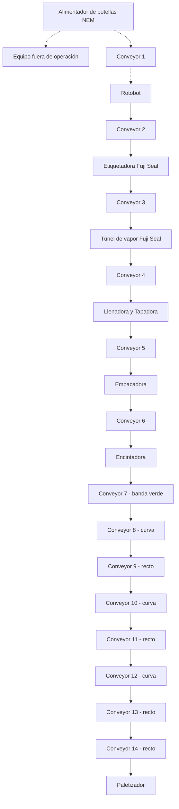

# Configuración de línea — Equipos, conveyors, sensores y distancias

Documento de referencia para identificar componentes, definir la secuencia de transporte y preparar una geometría de simulación. Los números **Conveyor 1–14** son identificadores propuestos, no etiquetas originales de PLC ni códigos oficiales. Las distancias se expresan en **cm**.

## Diagrama general

Las flechas punteadas indican una relación por definir. Se conserva la referencia «salida de llenadora» de la Serie A, que no coincide inequívocamente con la localización de «llenadora/tapadora» del diagrama.

## Catálogo de conveyors

| ID | Origen / destino o tramo | Componentes | Sensores | Geometría |
|---|---|---|---|---|
| **Conveyor 1** | NEM / sección inicial | Equipo anotado como fuera de operación; unión con Rotobot por confirmar. | No especificados | General |
| **Conveyor 2** | Rotobot → Etiquetadora Fuji Seal | 3 sensores SICK; modelo anotado WL12G-3B2531. | 3 SICK | General |
| **Conveyor 3** | Etiquetadora → Túnel de vapor Fuji Seal | 3 sensores SICK y otro punto sensor; sensor SICK interno se asocia a etiquetadora. | SICK | General |
| **Conveyor 4** | Túnel de vapor → Llenadora/Tapadora | Sensores de salida del túnel, rojos, azul/rojo; azules y gris en zona de entrada. | SICK / colores | General |
| **Conveyor 5** | Llenadora/Tapadora → Empacadora | Sensor(es) azules Wenglor, caja de acero y focos naranja/verde. | Wenglor / señalización | General |
| **Conveyor 6** | Empacadora → Encintadora | Banda verde, curva con sensor, otra banda verde, tramo metálico y sensor Diagraph. El croquis incluye una curva semicircular de **353.43 cm** de recorrido central y **38 cm** de ancho; su asociación exacta con este tramo requiere confirmación. | Curva (1) / Diagraph | Banda / curva / metálico |
| **Conveyor 7** | Salida de Encintadora | Banda verde de aprox. 100 cm; sensor a 5 cm del inicio. | 1 posición indicada | Banda verde |
| **Conveyor 8** | Encintadora → Paletizador, tramo 1 | Primera curva metálica. | No indicado | Curva |
| **Conveyor 9** | Encintadora → Paletizador, tramo 2 | Primer tramo recto metálico. | 1 | Recto |
| **Conveyor 10** | Encintadora → Paletizador, tramo 3 | Segunda curva metálica. | No indicado | Curva |
| **Conveyor 11** | Encintadora → Paletizador, tramo 4 | Segundo tramo recto metálico. | 1 | Recto |
| **Conveyor 12** | Encintadora → Paletizador, tramo 5 | Tercera curva metálica. | No indicado | Curva |
| **Conveyor 13** | Encintadora → Paletizador, tramo 6 | Tercer tramo recto metálico. | 3 | Recto |
| **Conveyor 14** | Encintadora → Paletizador, tramo 7 | Cuarto tramo recto; acceso al paletizador por confirmar como parte del mismo conveyor. | 1 | Recto |

## Sensores internos y equipos

| Equipo | Referencias |
|---|---|
| Alimentador | NEM / New England Machinery; nota sobre equipo fuera de operación. |
| Rotobot | Conveyor a etiquetadora, sensores SICK `WL12G-3B2531` (modelo anotado). |
| Etiquetadora | Fuji Seal; sensor interno SICK y sensores en transferencia. |
| Túnel de vapor | Fuji Seal; sensores antes y después del túnel. |
| Llenadora/Tapadora | Sensor interno, azules Wenglor y sensor en caja de acero. |
| Empacadora | Sensor interno SICK. |
| Encintadora | Sensor interno; referencia de 195 cm de equipo. |
| Paletizador | Acceso por conveyors metálicos curvos y rectos. |

**Conveyors 8 a 14:** curva → recto (1 sensor) → curva → recto (1 sensor) → curva → recto (3 sensores) → recto (1 sensor). Seis sensores señalados en los tramos rectos; las curvas no tienen una cantidad explícita.

## Secuencia de referencias dimensionales

Cada fila conserva la expresión de medida y su resultado aritmético. **El total es local a la anotación, no una progresiva global**; no sumar una cota interna de sensor como si fuera otro conveyor. Para generar posiciones absolutas primero deben fijarse los puntos de origen y los límites físicos de cada tramo.

### 1. Serie A — Etiquetadora y túnel

| N.º | Objeto o referencia | Expresión (cm) | Resultado (cm) | Observación |
|---:|---|---|---:|---|
| 1 | Conveyor inicial | `500 + 410` | 910 | — |
| 2 | Salida de llenadora | `500 + 159` | 659 | Confirmar relación con el diagrama |
| 3 | Primer sensor | `47` | 47 | — |
| 4 | Segundo sensor | `140` | 140 | — |
| 5 | Tercer sensor | `80` | 80 | — |
| 6 | Entrada a etiquetadora | `100` | 100 | — |
| 7 | Sensor interno de etiquetadora | `40` | 40 | — |
| 8 | Salida de etiquetadora | `70` | 70 | — |
| 9 | Sensor consecutivo 1 | `5` | 5 | — |
| 10 | Sensor consecutivo 2 | `5` | 5 | — |
| 11 | Sensor previo al túnel A | `80` | 80 | Descripción con corrección |
| 12 | Sensor previo al túnel B | `20` | 20 | — |
| 13 | Entrada al túnel | `452` | 452 | — |
| 14 | Salida del túnel | `19` | 19 | — |
| 15 | Sensor de salida del túnel | `109 + 172 + 184` | 465 | — |
| 16 | Sensor rojo 1 | `26 + 350 + 246` | 622 | — |
| 17 | Sensor rojo 2 | `121 + 88` | 209 | — |
| 18 | Sensor azul/rojo | `190` | 190 | — |

### 2. Serie B — Llenadora/Tapadora y Empacadora

| N.º | Objeto o referencia | Expresión (cm) | Resultado (cm) | Observación |
|---:|---|---|---:|---|
| 1 | Sensor azul/rojo | `24 + 157 + 52` | 233 | — |
| 2 | Sensor blanco antes de tapadora | `105` | 105 | — |
| 3 | Entrada a llenadora/tapadora | `224` | 224 | — |
| 4 | Tapadora | `148` | 148 | — |
| 5 | Salida de tapadora | `142` | 142 | — |
| 6 | Sensor azul | `105 + 60 + 132` | 297 | — |
| 7 | Sensor blanco | `181` | 181 | — |
| 8 | Focos naranja/verde | `247 + (68 + 27)` | 342 | Porción final indicada como curva |
| 9 | Inicio de empacadora | `125 + 35 + 325` | 485 | — |
| 10 | Sensor de caja | `53 + 80` | 133 | — |
| 11 | Inicio de conveyor verde | `194` | 194 | — |
| 12 | Sensor negro | `? + 42 + …` | — | Expresión incompleta |
| 13 | Conveyor verde | `180 + 110 + 85` | 375 | — |
| 14 | Diagraph / fin de banda | `70` | 70 | — |

### 3. Serie C — Encintadora y Paletizador

| N.º | Objeto o referencia | Expresión (cm) | Resultado (cm) | Observación |
|---:|---|---|---:|---|
| 1 | Inicio encintadora | `≈ 20 (195)` | 20 | 195 cm como referencia del equipo |
| 2 | Sensor interno encintadora | `195 − 20` | 175 | Complementa los 20 cm anteriores |
| 3 | Conveyor verde: inicio → sensor | `5 (conveyor: 100)` | 5 | Sensor a 5 cm de su inicio |
| 4 | Conveyor verde: resto | `100 − 5` | 95 | Complementa la banda de 100 cm |
| 5 | Conveyor / curva | `174 + (4 × 40 + 14)` | 348 | Curva |
| 6 | Conveyor recto | `290` | 290 | — |
| 7 | Sensor posterior | `483 + 442 + (4 × 40 + 29)` | 1114 | Incluye curva |
| 8 | Conveyor | `100` | 100 | Tipo no especificado |
| 9 | Sensor posterior | `129 + (4 × 40 + 13)` | 302 | Incluye curva |
| 10 | Inicio de conveyor paletizador | `40 (184)` | 40 | 184 cm entre paréntesis; interpretación pendiente |
| 11 | Sensor 1 | `42` | 42 | — |
| 12 | Sensor 2 | `77` | 77 | — |
| 13 | Sensor 3 | `29` | 29 | — |
| 14 | Conveyor a paletizador | `170 (175)` | 170 | 170 y 175 requieren distinguirse |
| 15 | Sensor en conveyor | `155` | 155 | Podría ser posición dentro del conveyor |

## Condiciones por precisar

- **Puntos de inicio:** determinar dónde está el cero de cada serie antes de generar una tabla de posiciones absolutas.
- **Ubicación de llenadora:** reconciliar la referencia «salida de llenadora» previa a etiquetadora con «llenadora/tapadora» posterior al túnel.
- **Sensor negro:** la expresión `? + 42 + …` está incompleta y no admite un total calculable.
- **Curva semicircular (180°) del croquis en forma de D:** distancia centro a centro entre sus extremos = **225 cm** (diámetro de la trayectoria central); ancho del conveyor = **38 cm**; radio central = **112.5 cm**. Longitud de recorrido sobre la línea central = **π × 225 / 2 = 353.43 cm (3.5343 m)**. Como referencia, los bordes interior y exterior miden aproximadamente **293.74 cm** y **413.12 cm**, respectivamente. La curva está provisionalmente relacionada con Conveyor 6, a falta de confirmar el tramo físico exacto. Las expresiones `4 × 40 + x` corresponden a sumas lineales separadas, no a radios de esta curva.
- **Valores entre paréntesis:** `40 (184)` y `170 (175)` no deben sumarse indiscriminadamente. La cota `155 cm` del último sensor podría ser interna al conveyor.
- **Separaciones físicas:** los Conveyors 1, 4, 5 y 6 son tramos funcionales; comprobar si están compuestos por varios módulos motorizados.
- **Sensores:** vincular color, fabricante, referencia y distancia desde el inicio de cada conveyor para su posterior parametrización.

### Convención para integración con SimuLine

Usar `CV-01` a `CV-14` en identificadores estructurados y **Conveyor 1** a **Conveyor 14** en pantalla. Mantener los sensores internos como propiedades de su máquina, separados de los sensores de conveyor. Falta definir velocidades, capacidades, anchos y controles antes de emplear estos tramos como geometría definitiva.
